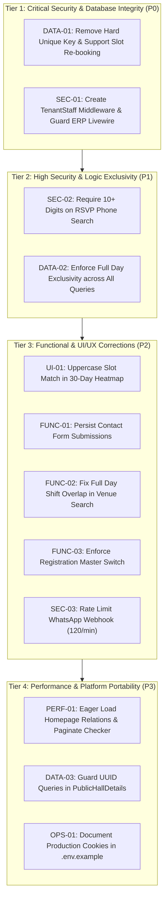

# Enterprise Remediation Roadmap & Execution Plan

> **Document Version:** 1.0.0-GA  
> **Status:** Awaiting Stakeholder Authorization Before Code Changes  
> **Target System:** EventHub Platform

---

## 1. Remediation Sequencing by Risk & Dependency

Fixes are strictly sequenced in 4 dependency tiers to ensure that database migrations and core authorization boundaries are established before UI and performance refinements:



---

## 2. Detailed Task Specification & Acceptance Criteria

### Tier 1: Critical Security & Database Integrity (P0)

#### Task 1.1: Resolve Database Cancellation Deadlock (`DATA-01`)
- **Objective:** Allow cancelled bookings and inquiry slots to be re-booked without triggering a unique key violation.
- **Affected Files:**
  - `database/migrations/2026_10_09_000003_create_bookings_table.php`
  - `database/migrations/2026_10_18_000001_relax_unique_constraint_on_bookings_table.php` (New Migration)
  - `app/Services/BookingService.php`
- **Action Plan:**
  1. Create a migration dropping `uq_hall_event_slot` from `bookings`.
  2. Rely on the atomic distributed mutex `lock:hall:{$id}:date:{$date}` and `slotConflictQuery()->lockForUpdate()` in `BookingService`, which checks `status IN ('HOLD', 'CONFIRMED')`.
  3. Add a dedicated regression test verifying that cancelling a booking frees the slot for immediate reservation.
- **Acceptance Criteria:** A cancelled booking does not block a new booking on the same hall, date, and shift.

#### Task 1.2: Enforce Tenant Staff Boundary on All ERP Components (`SEC-01`)
- **Objective:** Prevent customer accounts or users without a `tenant_id` from accessing internal vendor management tools.
- **Affected Files:**
  - `app/Http/Middleware/EnsureTenantStaff.php` (New Middleware)
  - `bootstrap/app.php`
  - `routes/web.php`
  - `app/Livewire/FloorPlanDesigner.php`
  - `app/Livewire/KitchenKotBoard.php`
  - `app/Livewire/UtilityFuelTracker.php`
  - `app/Livewire/WhatsAppRsvpManager.php`
  - `app/Livewire/HallMediaManager.php`
- **Action Plan:**
  1. Create `EnsureTenantStaff` middleware verifying:
     ```php
     if (!$user || !$user->tenant_id || $user->isCustomer()) {
         return redirect()->route('customer.dashboard');
     }
     ```
  2. Wrap all vendor ERP routes in `routes/web.php` with `EnsureTenantStaff`.
  3. In each component's `mount()`, add an affirmative check:
     ```php
     if (!$user || !$user->tenant_id || $user->isCustomer()) {
         abort(403, 'Unauthorized. Tenant staff access required.');
     }
     ```
- **Acceptance Criteria:** A user with `ROLE_CUSTOMER` receives 403 or is redirected to `/customer/dashboard` when accessing any vendor ERP tool.

---

### Tier 2: High Security & Logic Exclusivity (P1)

#### Task 2.1: Secure Public Guest RSVP Search (`SEC-02`)
- **Objective:** Eliminate phone enumeration and customer data leakage.
- **Affected Files:**
  - `app/Livewire/PublicGuestRsvp.php`
- **Action Plan:**
  1. Clean input: `$clean = preg_replace('/[^0-9]/', '', $this->phone)`.
  2. If `strlen($clean) < 10`, return early with an error message.
  3. Search strictly on normalized 10 or 11 digits:
     ```php
     $last10 = substr($clean, -10);
     $this->foundRsvp = GuestRsvp::where('phone', 'like', "%{$last10}")->first();
     ```
- **Acceptance Criteria:** Searching with 1 to 9 digits returns 0 results and shows a validation notice.

#### Task 2.2: Ensure Full Day Shift Exclusivity in Queries (`DATA-02`)
- **Objective:** Ensure single shifts cannot overlap with full-day bookings.
- **Affected Files:**
  - `app/Services/BookingService.php`
- **Action Plan:**
  Ensure `slotConflictQuery` always pairs any single shift with `FULL_DAY`, and full day with all shifts.

---

### Tier 3: Functional & UI/UX Polish (P2)

#### Task 3.1: Fix Uppercase Slot Match in 30-Day Heatmap (`UI-01`)
- **Affected File:** `app/Livewire/PublicVenues.php`
- **Action:** Change `firstWhere('slot_type', 'afternoon')` to `firstWhere('slot_type', 'AFTERNOON')` (and `EVENING`, `NIGHT`).
- **Acceptance Criteria:** The availability heatmap correctly renders booked shift counts.

#### Task 3.2: Persist Public Contact Form Inquiries (`FUNC-01`)
- **Affected Files:**
  - `database/migrations/2026_10_18_000002_create_contact_inquiries_table.php` (New Migration)
  - `app/Models/ContactInquiry.php` (New Model)
  - `app/Livewire/PublicContact.php`
- **Action:** Insert inquiry into database and log submission.
- **Acceptance Criteria:** Submissions persist in the database and appear in Super Admin Tasks desk.

#### Task 3.3: Respect Registration Master Switch (`FUNC-03`)
- **Affected File:** `app/Livewire/Auth/Register.php`
- **Action:** Check `Cache::get('platform_vendor_registration_open', true)` in `mount()` and `register()`.
- **Acceptance Criteria:** Registration returns error when the master switch is toggled off.

#### Task 3.4: Rate Limit WhatsApp Webhook (`SEC-03`)
- **Affected File:** `routes/web.php`
- **Action:** Add `->middleware('throttle:120,1')` to `/webhooks/whatsapp`.

---

### Tier 4: Performance & Platform Portability (P3)

#### Task 4.1: Eliminate Homepage N+1 & Paginate Availability (`PERF-01`)
- **Affected Files:** `routes/web.php`, `app/Livewire/PublicAvailabilityChecker.php`
- **Action:** Add `with(['venue', 'tenant'])` on homepage query; add 12-item pagination to availability checker.

#### Task 4.2: Guard UUID Queries in PublicHallDetails (`DATA-03`)
- **Affected File:** `app/Livewire/PublicHallDetails.php`
- **Action:** Use `when(Str::isUuid($identifier), fn($q) => $q->orWhere('id', $identifier))` to avoid PostgreSQL errors.

#### Task 4.3: Document Production Cookies (`OPS-01`)
- **Affected File:** `.env.example`
- **Action:** Add `SESSION_SECURE_COOKIE=true` with explanation.

---

## 3. Verification Protocol & Quality Gates

Each tier will be validated using this sequence:
1. **Targeted Feature Test Execution:** Run the newly added regression test class.
2. **Full Test Suite Execution:** Verify all 54 existing suites continue to pass with 0 regressions (`php artisan test`).
3. **Asset Compilation:** `npm run build` to ensure clean Vite bundle generation.
4. **Cache Reset:** `php artisan optimize:clear`.
